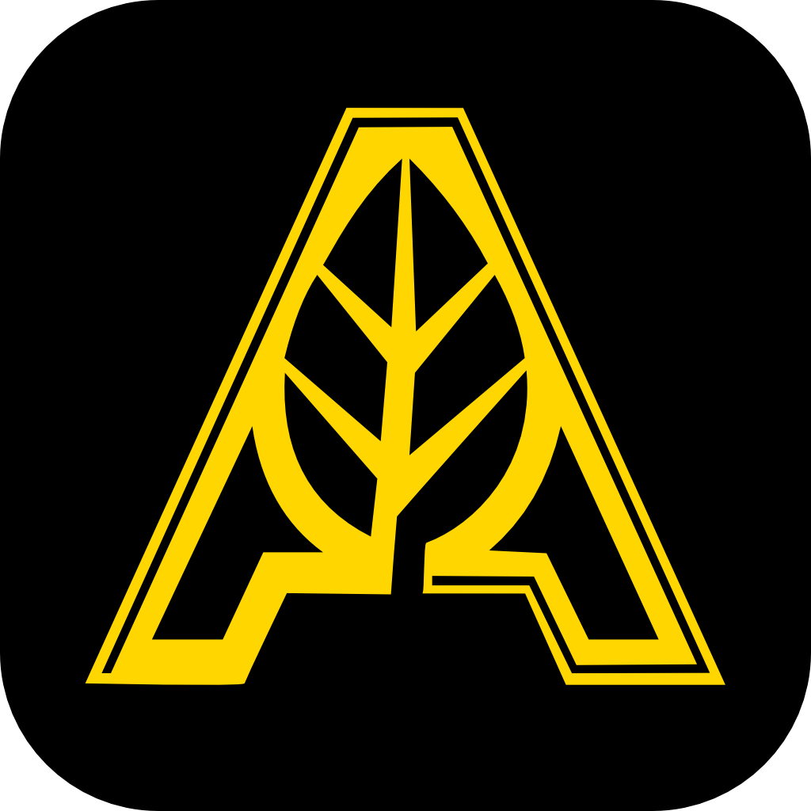

  

<h1 align="center">Aruda Labs</h1>

Modular Infrastructure • Open Hardware • Homelab Innovation

---

## About

Aruda Labs designs modular hardware for homelabs, edge deployments, and small-scale infrastructure environments.

Our focus is on creating practical, scalable systems that bridge the gap between consumer hardware and enterprise infrastructure.

### Areas of Development

- Modular server rack systems
- NAS chassis and storage platforms
- Open hardware designs
- Edge computing infrastructure
- Homelab solutions
- Embedded hardware projects

---

## Mission

Build infrastructure hardware that is accessible, repairable, and designed to evolve alongside the needs of makers, enthusiasts, and professionals.

---

## Current Projects

### Modular Rack Platform
A scalable rack ecosystem designed for homelabs and edge deployments.

### NAS Chassis Development
Storage-focused systems designed around flexibility, cooling, and maintainability.

### Open Hardware Initiatives
Documentation and hardware specifications intended to encourage community collaboration.

---

## Repositories

| Repository | Description |
|------------|-------------|
| website | Official Aruda Labs website |
| documentation | Product and technical documentation |
| hardware | Mechanical designs and hardware resources |
| firmware | Embedded and device firmware |
| cad | CAD models and engineering files |

---

## Connect

🌐 Website: https://arudalabs.com

📧 Contact: contact@arudalabs.com

📖 Documentation: https://github.com/arudalabs

---

Building the future of modular infrastructure.

